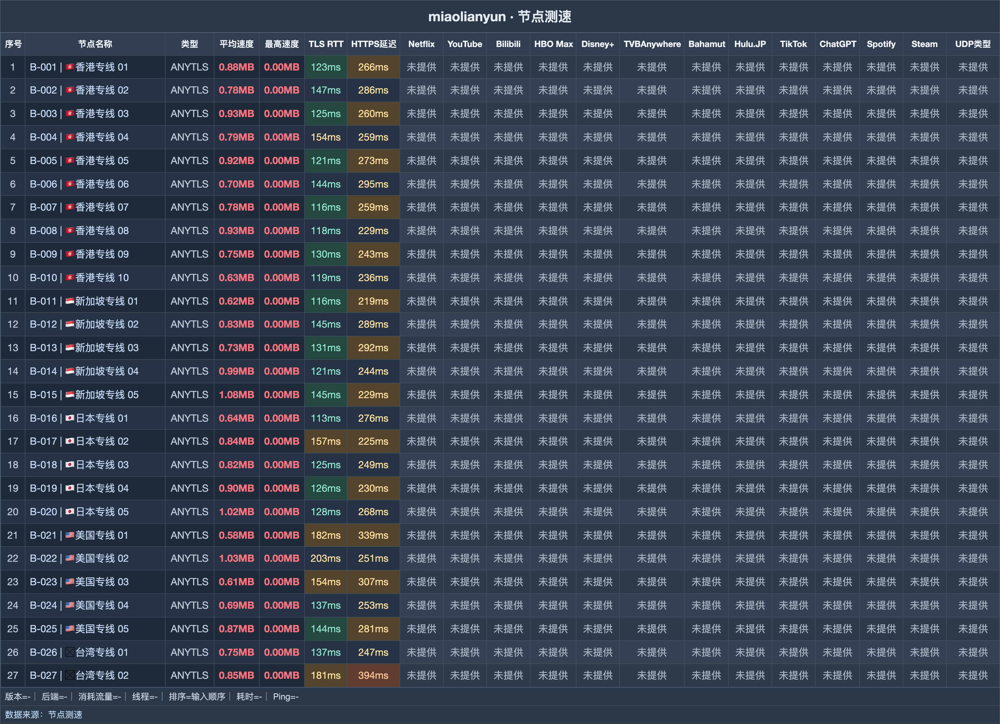

# 秒连云机场｜120G 从 8 元月付起，全档统一 160 Mbps（2026-10-28 更新）

> **一句话评价：所有节点按 1 倍计费，留存测试 27/27 连通；升档主要换流量，适合先用入门档验证。**
>
> 👉 **[官网注册](https://mly518.com/#/register?code=IDN5bnoG)** · 先选 8 元 Air 月付，实际流量吃紧时再换更高额度。

**适合：**

- 首次挑机场，希望先用最低月付档体验。
- 想减少倍率计算和挑选成本，倾向导入后直接试用。
- 以视频追剧为主，港新日该轮延迟为 116–154ms。

**不适合：**

- 打算靠升套餐提高限速，全档上限都为 160 Mbps。
- 忽略付款周期只比较标价；年付活动和不限时包需要分开计算。

| 选购项 | 内容 |
|---|---|
| 月付起点 | 8 元/月 120G |
| 节点记录 | 27 个，该轮全部连通 |
| 延迟中位 | 133 ms |
| 速度中位 | 6.7 MB/s |
| 最快平均速度 | 8.8 MB/s |
| 计费倍率 | 全部 1 倍 |
| 统一限速 | 160 Mbps |
| 协议 | AnyTLS |

**关于秒连云**：秒连云（miaolianyun）采用 AnyTLS，提供普通周期套餐、年付活动和不限时包。比较秒连云价格时，先确定自己需要的每月流量，再对比一次性购买与年度商品。

## 套餐

| 套餐名称 | 流量 | 设备 | 限速 | 一次付 | 月付 | 季付 | 半年 | 年付 | 两年 | 三年 |
|---|---|---|---|---|---|---|---|---|---|---|
| 150G/月 年付活动 | 150G | — | 160M | — | — | — | — | 118 | — | — |
| 220G/月 年付活动 | 220G | — | 160M | — | — | — | — | 168 | — | — |
| Air 120G | 120G | — | 160M | — | **8 元** | 24 | 48 | 96 | — | — |
| Base 220G | 220G | — | 160M | — | **15 元** | 45 | 90 | 180 | — | — |
| Pro 320G | 320G | — | 160M | — | **22 元** | 66 | 132 | 262 | — | — |
| Max 520G | 520G | — | 160M | — | **28 元** | 82 | 162 | 320 | — | — |
| 120G不限时 | 120G 一次性 | — | 160M | **38 元** | — | — | — | — | — | — |
| 320G不限时 | 320G 一次性 | — | 160M | **78 元** | — | — | — | — | — | — |
| 980G不限时 | 980G 一次性 | — | 160M | **198 元** | — | — | — | — | — | — |

> 160 Mbps 是全档统一限速，增加流量不会同时提高速度。年付活动属于独立商品，并非普通档位折扣。月付每元流量约 15～19 GB/元，对应 Pro 320G 到 Max 520G。

## 测速

留存测速共 **27 个节点**，**27/27 连通**，最快节点平均速度 **8.8 MB/s**。下表按平均速度选出靠前的记录，图示位置见下图。

测试时间为 **2026-10-17 18:20–18:26**；环境为中国大陆家宽出口香港，每节点连测 **3 次取最优**。

| 节点名称 | 协议类型 | 延迟 | 完整请求 | 平均速度 | 最高速度 |
|---|---|---|---|---|---|
| 🇸🇬新加坡专线 05 | ANYTLS | 148ms | 229ms | **8.77 MB/s** | 11.29 MB/s |
| 🇺🇸美国专线 02 | ANYTLS | 198ms | 248ms | **8.44 MB/s** | 12.65 MB/s |
| 🇯🇵日本专线 05 | ANYTLS | 130ms | 262ms | **8.29 MB/s** | 12.72 MB/s |
| 🇸🇬新加坡专线 04 | ANYTLS | 123ms | 240ms | **8.11 MB/s** | 11.52 MB/s |
| 🇭🇰香港专线 08 | ANYTLS | 118ms | 234ms | **7.71 MB/s** | 11.13 MB/s |
| 🇭🇰香港专线 03 | ANYTLS | 123ms | 257ms | **7.67 MB/s** | 12.25 MB/s |
| 🇭🇰香港专线 05 | ANYTLS | 123ms | 276ms | **7.54 MB/s** | 11.02 MB/s |
| 🇯🇵日本专线 04 | ANYTLS | 123ms | 231ms | **7.42 MB/s** | 11.81 MB/s |

**地区分布**：节点分布合计 27：香港 10，新加坡、日本、美国各 5，台湾 2。港新日的该轮延迟范围是 116–154ms。

## 怎么选

- 先从 8 元 Air 120G 月付验证线路；全档为 160 Mbps，只有额度不足时才需要升档。
- 看视频可先试香港、新加坡、日本，留存读数区间为 116–154ms。使用稀疏且 120G 能用很久时，38 元不限时包相当于 4.75 个月月付成本，用得久再选。
- 准备年付时，将 150G/月 118 元活动与 Air 120G 年付并排比：前者多 22 元、每月多 30G。短期还没确定适配的人，先不急着转年度。

## 注册

👉 **[官网注册](https://mly518.com/#/register?code=IDN5bnoG)** · 先选 8 元 Air 月付，实际流量吃紧时再换更高额度。

*本文含推广链接，经此入口注册或购买，本站可能获得佣金。*

## 更新

- **2026-10-18** — 已有价格复核保留 AIR 8元/月；例行连通记录仍为 27/27。
- **2026-10-17** — 全节点复测留存 27/27 连通，延迟中位 133ms，最快平均速度 8.8 MB/s。

---
*测速记录日期 2026-10-17 18:20–18:26，中国大陆家宽出口香港，每节点连测 3 次取最优。*
*价格与套餐以商家实时显示为准。*

展开相关搜索词

相关关键词：秒连云、miaolianyun、秒连云机场、秒连云套餐、秒连云官网、秒连云注册、秒连云入口、秒连云测速、机场推荐、机场测评、机场推荐2026、科学上网、clash订阅、代理订阅、VPN

